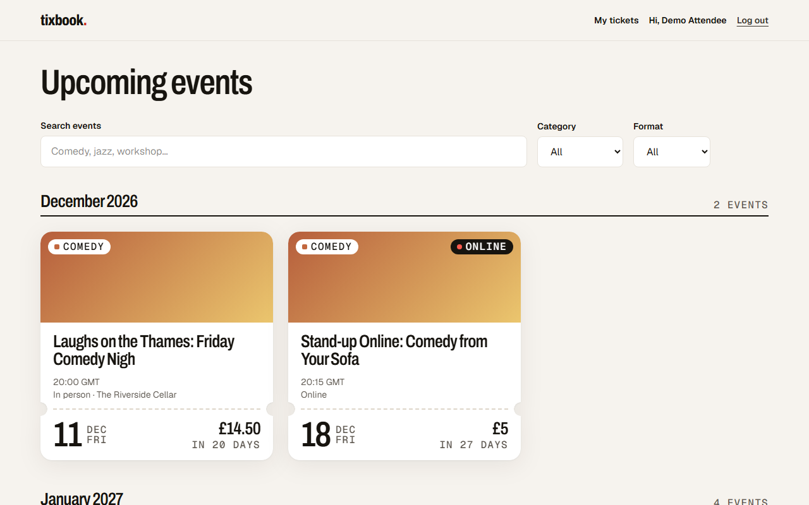
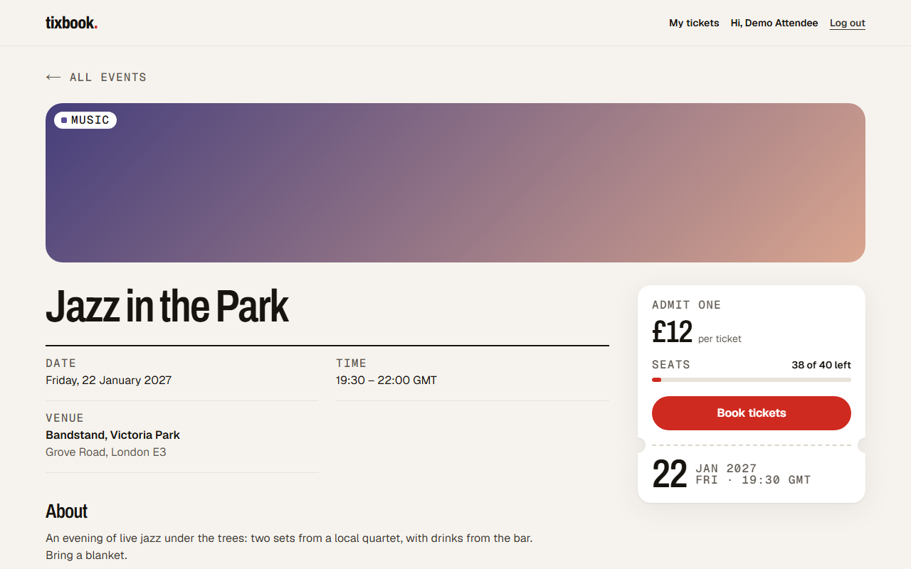
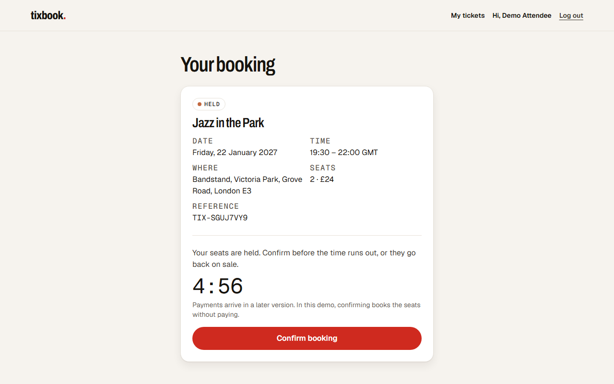
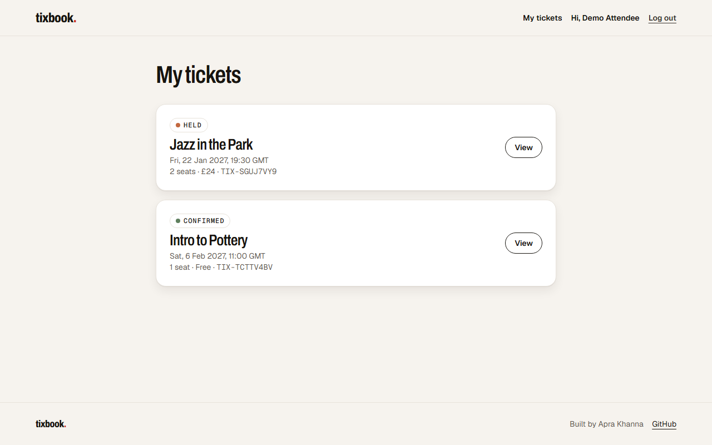
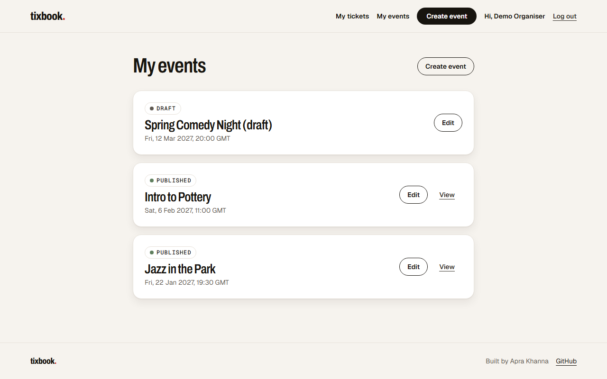
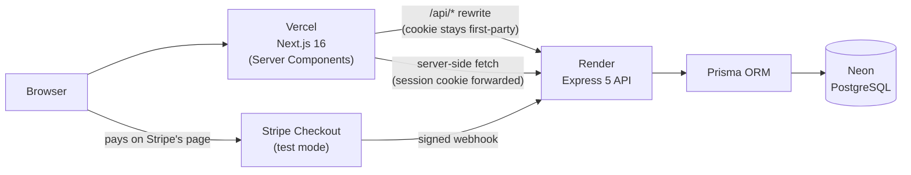

# Tixbook

An event and ticket booking app where organisers publish events, attendees book seats, and the same seat is never sold twice.

**Live:** https://tix-book.vercel.app · **API:** https://tixbook-api.onrender.com/api/v1/events

> ⏳ **The first load can take up to a minute.** The API runs on Render's free plan, which sleeps after 15 minutes without traffic. If you see *"Couldn't load events"*, wait a few seconds and press **Retry**. That screen is designed for exactly this.

## The problem

When many people try to book the last few seats of an event at the same moment, each request reads "5 seats left" before any of them has saved anything. Without protection, all of them succeed and the event is oversold. Tixbook is built around getting this right: exactly as many bookings as there are seats, a repeated click or retry counts once, and seats held by someone who doesn't finish are released after 5 minutes. Paying works the same way: a booking is confirmed only by Stripe's signed webhook, the same webhook arriving twice changes nothing twice, and a payment that arrives after the seats were released is refunded automatically.

## Highlights

- **Auth built from scratch:** database sessions in httpOnly cookies (only a SHA-256 hash of the token is stored), Argon2id password hashing, Google login with OAuth 2.0 + PKCE, roles, and a CSRF check on every write ([decisions 023, 024, 027, 029](./DECISIONS.md)).
- **Booking that can't oversell:** each booking locks the event row (`SELECT ... FOR UPDATE`), counts seats and inserts in one transaction. 20 simultaneous requests for 5 seats give exactly 5 bookings; with the lock removed, the same kind of test sold 10 seats for 5 places.
- **Idempotency:** a key made in the browser plus a unique constraint, so double clicks and retries are one booking, even when two identical requests arrive at the same moment.
- **Locking, measured, not guessed:** optimistic vs pessimistic with 40 simultaneous bookings. Optimistic was faster when most requests were refused (~1.9 s vs ~2.5 s), but nearly 2x slower with ~260 retries when everyone could get a seat (~5.9 s vs ~3.1 s), so the row lock stays ([decision 038](./DECISIONS.md)).
- **Cursor (keyset) pagination** on `(startsAt, id)`: stable when events are added or removed, no duplicates or gaps ([decision 030](./DECISIONS.md)).
- **Payments with Stripe (test mode):** Stripe Checkout, confirmed only by a **signed webhook**, never by the redirect page. Duplicate webhooks are handled twice over (handled-event ids, and the payment id stored on the booking under the row lock); a payment that arrives after the hold ended is confirmed if seats are still free, otherwise refunded with an idempotency key ([decisions 041–045](./DECISIONS.md)).
- **Signed tickets:** the QR code is a JWT (HS256, with the algorithm, issuer, audience and expiry all checked). The door check also asks the database, because a JWT can't be revoked: a refunded ticket is refused ([decision 046](./DECISIONS.md)).
- **Organiser dashboard:** confirmed, held and left seats and revenue per event, from the same counting rule as "seats left" in one grouped query; attendees by name only ([decision 048](./DECISIONS.md)).
- **Accessibility:** axe (WCAG 2.2 A + AA) runs on 15 page states with no violations, plus a manual keyboard pass, a native `<dialog>` focus trap, and screen-reader live regions for toasts and the countdown.
- **Tests:** 117 API tests (Jest + Supertest), 156 web unit and component tests (Jest + React Testing Library), 17 end-to-end tests (Playwright: the full booking and payment flow, two users at once, axe on every page state). Important tests were proven by breaking the code on purpose and watching them fail.

## Screenshots

| | |
|---|---|
|  |  |
| **Find events:** search, filters and cursor pagination | **Event page:** seats left from the same calculation as the list |
|  |  |
| **Booking:** seats held for 5 minutes, countdown from the server's clock | **My tickets:** every booking with its status and reference |
|  | |
| **My events:** an organiser's own events, drafts included | |

Screenshots use throwaway test data.

## Demo video

> 🎬 **Placeholder:** a 2–3 minute demo video will go here.

## Architecture



The browser only ever talks to the Vercel site. Pages are Server Components that fetch from the API on the server, so the API's address stays in a server-only environment variable. Requests from the browser (logging in, booking) go to `/api/*` on the same site, and Vercel rewrites them to the Express API on Render. That keeps the session cookie first-party and means no CORS setup is needed. The API enforces every rule (who is logged in, roles, who owns an event, seats left), because the client can always be bypassed. Payments go the other way round: the browser pays on Stripe's own page, and Stripe tells the API by calling its webhook directly (signed with a shared secret). That webhook is the only thing that confirms a booking. Prisma talks to PostgreSQL on Neon; the seat lock is raw SQL, because Prisma has no `FOR UPDATE`.

## Key decisions and trade-offs

Every decision, with the options considered, is in [DECISIONS.md](./DECISIONS.md).

| Decision | Chose | Trade-off |
|---|---|---|
| [023](./DECISIONS.md) Login | Database sessions built myself, not JWT (logout and revocation are instant) | More security risk and time than an auth library |
| [024](./DECISIONS.md) Passwords | Argon2id (OWASP minimum settings) | A native package instead of Node's built-in scrypt |
| [030](./DECISIONS.md) Pagination | Cursor (keyset) on `(startsAt, id)` | No "jump to page 5" |
| [032](./DECISIONS.md) Another organiser's event | 404, same as an unknown id | Less precise than 403, but never confirms the event exists |
| [034](./DECISIONS.md) Double booking | Row lock on the event (`SELECT ... FOR UPDATE`) | Raw SQL (Prisma has no `FOR UPDATE`), and bookings for one event run one at a time |
| [035](./DECISIONS.md) Expired holds | Lazy expiry, no cron job | The stored status can lag; seats left always uses the hold's end time |
| [041](./DECISIONS.md) Paying after the hold ended | Re-check under the row lock: confirm if seats are free, else refund | A customer can occasionally be charged and refunded |
| [042](./DECISIONS.md) Duplicate webhooks | Handled-event table **and** the payment id on the booking | One more table; a test proved the table alone isn't enough |
| [046](./DECISIONS.md) Tickets | Signed JWT + a database check at the door | The door check needs the API; offline scanning would need public-key signing |
| [048](./DECISIONS.md) Dashboard | Attendee names only, one counting rule | Organisers can't email attendees directly (yet) |

## Concurrency results

What the tests and the locking lab proved, on the dev database:

| Test | Result |
|---|---|
| 20 simultaneous requests for 1 seat each, 5 seats | Exactly 5 booked, 15 refused, 5 seats taken |
| 10 simultaneous requests for 2 seats each, 5 seats | Exactly 2 booked (4 seats), 1 seat still free |
| The same 2-seat test with `FOR UPDATE` removed | 5 bookings: **10 seats sold for 5 places** |
| Optimistic version, 15 requests for 5 seats | 5 booked; without its version check, 13 booked |
| Two identical requests (same idempotency key) at once | One booking; one answer 201, the other 200 |
| Two transactions locking two events in opposite order | Postgres cancels one: `40P01 deadlock detected` |

Measured with `npm run lab:locking` (40 simultaneous bookings, 3 rounds each):

| Scenario | Pessimistic (row lock) | Optimistic (version + retry) |
|---|---|---|
| Mostly sold out (10 seats) | ~2.5 s, 0 retries | ~1.9 s, 7 retries |
| Room for everyone (40 seats) | ~3.1 s, 0 retries | ~5.9 s, ~260 retries |

The booking API can't deadlock this way, because each booking locks exactly one event row.

## What broke after launch

Real problems from running the live app, and what changed because of them:

- **Running the seed locally wiped the live data (6 Nov).** My laptop and Render used the same database, and the seed deletes everything before inserting. It also crashed halfway once, leaving the database empty. Fix: separate dev and production databases (Neon branches), the seed runs in one transaction, and it refuses to run unless the database host is the dev one (decisions 019 and 020).
- **The first visit hung on a loading skeleton.** Render's free plan sleeps, and waking up takes about a minute. Fix: a 10-second timeout and an error page that says the server may be waking up, with a Retry button (decision 017).
- **Login forms kept old passwords and errors after navigating away (16 Nov, #27).** With Cache Components, Next.js hides pages instead of removing them, so form state stays. Fix: clear login and sign-up forms when the page is hidden, plus a test that hides and shows the form.
- **A Next.js security release (17 Nov, #32).** Upgraded to Next.js 16.4.6 the same day.

Caught before release (phase 5):

- **A migration file Postgres couldn't read.** Windows PowerShell 5.1 saved it with an invisible byte-order mark: `syntax error at or near "\u{feff}"`. Nothing was applied; I removed the 3 bytes and, before merging, checked the first bytes of the file in the commit itself.
- **A dashboard count the tests didn't cover.** Breaking the count on purpose passed every test, because the dashboard saves expired holds before counting. The My events list doesn't, so it would have shown run-out holds as "held". A new test catches it.

Caught before release (phase 4):

- **"Confirm booking" did nothing.** The "Book tickets" dialog stayed open on the hidden event page (Next.js keeps pages you leave, hidden). A dialog opened with `showModal()` stays modal while hidden: invisible, but it made the booking page ignore every click. Fix: the Modal closes its dialog when its page is hidden, and the booking dialog closes before navigating. Found in a real browser; tests now cover it.
- **The "someone else just got the last seats" message vanished.** After a sold-out answer, the page refreshed the seat count, the panel switched to "Sold out" and removed the dialog, message included. Fix: only the button changes; the dialog stays until it's closed. Found by the end-to-end test with two users.

Open questions I haven't solved yet are in [QUALITY_NOTES.md](./QUALITY_NOTES.md#open-questions).

## Tech stack

| Layer | Choice |
|---|---|
| Frontend | Next.js 16 (App Router, Server Components, Cache Components), React 19, TypeScript, Tailwind CSS v4 |
| API | Node.js, Express 5, TypeScript, Zod validation |
| Auth | Database sessions (own code), Argon2id password hashing, Google login with Arctic |
| Payments and tickets | Stripe Checkout and webhooks (test mode), JWT tickets with jose, QR codes with qrcode |
| Database | PostgreSQL (Neon) with Prisma ORM and migrations |
| Tests | Jest + Supertest (API), Jest + React Testing Library (web), Playwright + axe (end-to-end and accessibility) |
| Hosting | Vercel (frontend), Render (API), Neon (database), all on free plans |

## Run it locally

You need Node.js 22 and a PostgreSQL database for development (for example a free Neon branch). Never point a local `.env` at a production database.

**Environment variables.** Each app has an example file with every variable it reads, with placeholder values and a comment on each:

- [`api/.env.example`](./api/.env.example) → copy to `api/.env`: `DATABASE_URL` (the dev database), `SEED_ALLOWED_HOST` (the seed refuses to run on any other host), optional `PORT`, and the optional `GOOGLE_*` settings for "Continue with Google"
- [`web/.env.example`](./web/.env.example) → copy to `web/.env.local`: `API_URL`, the address of your local API

```bash
# API (port 4000)
cd api
npm install
# create api/.env from api/.env.example
npx prisma migrate dev --config prisma7.config.ts
npx prisma db seed --config prisma7.config.ts   # ⚠️ deletes all data first (dev only)
npm run dev
```

Payments (optional): put your Stripe **test** keys and a `TICKET_JWT_SECRET` in `api/.env` (see `api/.env.example`), then forward Stripe's webhooks to your local API in another terminal. It prints the `STRIPE_WEBHOOK_SECRET` to use:

```bash
stripe listen --forward-to localhost:4000/api/v1/payments/webhook
```

```bash
# Frontend (port 3000), in a second terminal
cd web
npm install
# create web/.env.local from web/.env.example
npm run dev
```

### Tests

| Where | Command | What runs |
|---|---|---|
| `api/` | `npm test` | 117 API tests (Jest + Supertest). They use the dev database and delete their own test data. Stripe is never called: its network calls are replaced, and webhooks are signed with a test secret. |
| `web/` | `npm test` | 156 unit and component tests (Jest + React Testing Library) |
| `web/` | `npm run test:e2e` | 17 end-to-end and accessibility tests (Playwright + axe). Starts the local API and web app, or reuses running ones. Run `npx playwright install chromium` once first. The payment test needs Stripe set up locally (it skips otherwise). |
| `api/`, `web/` | `npm run lint` | ESLint; in `web/` this includes the jsx-a11y accessibility rules |
| `api/` | `npm run lab:locking` | The locking benchmark (dev database only) |

## Roadmap

| Phase | Focus | Status |
|---|---|---|
| 1 | Foundations: schema, API, event pages, deploy | ✅ Done |
| 2 | Auth and security: login, roles, OAuth, CSRF | ✅ Done |
| 3 | Search, pagination, my events and editing, UI kit, accessibility, end-to-end tests | ✅ Done |
| 4 | Booking and concurrency: 5-minute seat holds, row locking, idempotency, "My tickets" | ✅ Done |
| 5 | Payments: Stripe Checkout, signed webhooks, refunds, signed ticket QR codes, organiser dashboard | ✅ Done |
| 6 | Background jobs: confirmation and reminder emails, retries | Next |
| 7 | Performance: indexes, caching, rate limiting, Core Web Vitals | Planned |
| 8 | Docker, CI/CD, monitoring | Planned |
| 9 | Real users, load test, "How I'd scale this" | Planned |

Payments use Stripe's **test mode**: no real money. Pay with the test card `4242 4242 4242 4242`, any future date and any CVC.

## Project docs

- [DECISIONS.md](./DECISIONS.md): decisions and trade-offs
- [QUALITY_NOTES.md](./QUALITY_NOTES.md): testing approach, known issues and open questions
- [LEARNING_LOG.md](./LEARNING_LOG.md): what I learned at each step, including mistakes
- [AI_USAGE.md](./AI_USAGE.md): how I use AI on this project
- [docs/](./docs): database schema and screenshots

---

Built by Apra Khanna.
